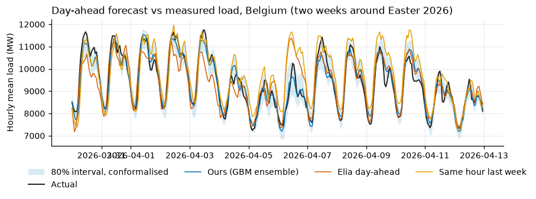
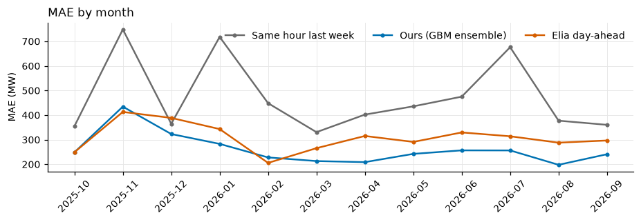
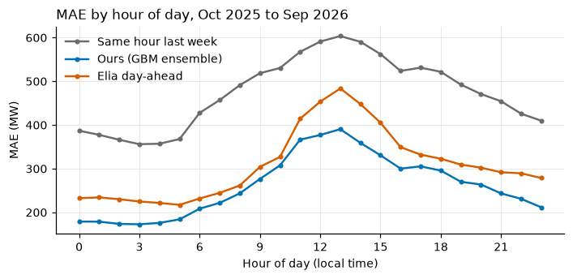
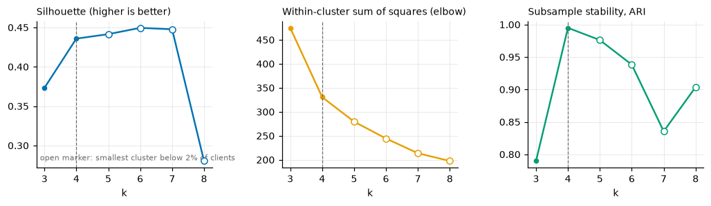
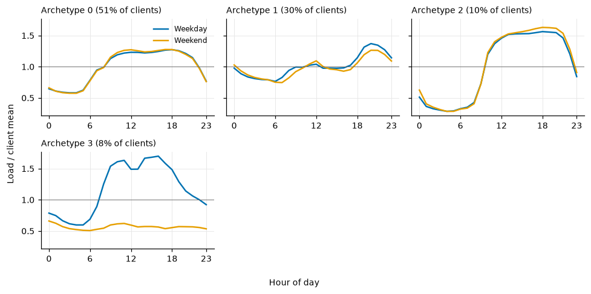
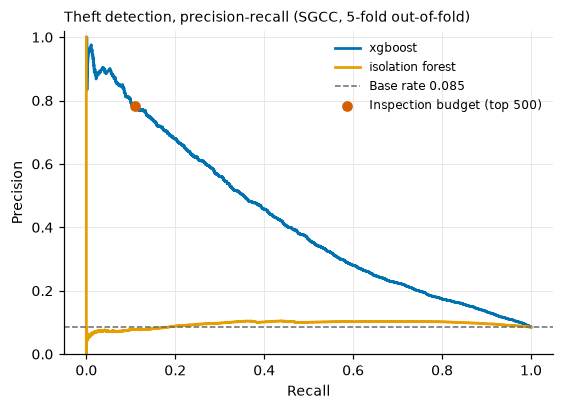

# Energy Consumption Analytics

Day-ahead load forecasting benchmarked against the Belgian TSO's own forecast, customer load profiling,
electricity-theft (non-technical loss) detection and data-quality checks. Public data only. Every number
below was produced by the code in this repository and is copied from `docs/results/`.

## Why I built this

I lead a data analytics team in internal audit, and a lot of my working life is spent asking whether a
number can be trusted: a forecast, a loss estimate, a meter reading. Energy data is a good place to practise
that because the questions are concrete and the public data is good enough to answer them honestly.

I wanted to test three things end to end. First, whether a model I build myself can beat a forecast that a
transmission system operator publishes every day, under the same information set. Second, how far a theft
detector gets on the only labelled public theft data when it is tuned without peeking at its own test fold.
Third, whether I can find problems in the data before the models do. This is my own portfolio work, built on
open data.

## What is in the repo

| Module | What it does | Entry point |
|---|---|---|
| Forecasting | Hourly day-ahead load for Belgium (Elia) with a gate-closure information set, seasonal naive and MSTL baselines, LightGBM and XGBoost tuned with Optuna, quantile models with conformal calibration, day-block bootstrap against Elia's own forecast. The same pipeline runs on Denmark and on the older UCI data | `energy forecast --market elia\|dk\|uci`, `energy tune` |
| Load profiling | Normalised weekday and weekend profiles per client, k-means archetypes, k chosen with silhouette, elbow and stability | `energy profile` |
| Theft / NTL | Drop, peer, zero-run, weekly-break and shape features; Isolation Forest baseline; XGBoost tuned with Optuna inside a nested stratified CV; precision at an inspection budget with bootstrap CIs | `energy theft` |
| Data quality | Meter-level checks (UCI) and a system-load report (Elia) | `energy dq [--dataset elia]` |

```
src/energy/   markets.py  forecast.py  baselines.py  tune.py  evaluation.py  experiments.py
              theft.py  profiling.py  dq.py  data.py  plots.py  synth.py  cli.py
tests/        offline tests on synthetic data and small fixtures (Elia CSV, Energinet JSON)
docs/         figures, dq reports, results/ (CSV, JSON and markdown tables behind every number)
```

## Data and licences

| Dataset | Used for | Terms |
|---|---|---|
| [Elia Open Data](https://opendata.elia.be), dataset `ods001`: measured total load, quarter-hourly, with Elia's own day-ahead, week-ahead and most-recent forecasts and its day-ahead p10/p90 band. I use 2023-01-01 to 2026-09-30 (131,424 quarter-hours) | primary forecasting data and the benchmark | Elia Open Data Licence (the licence named in the dataset metadata; attribution to Elia), no key |
| [Open-Meteo](https://open-meteo.com) historical forecast API and previous-runs API: temperature, shortwave radiation, cloud cover and wind at Brussels, Antwerp and Liege | weather features | CC BY 4.0, no key |
| [Energinet Energi Data Service](https://www.energidataservice.dk), `ProductionConsumptionSettlement`, DK1 gross consumption, hourly | second market | Energinet open data terms, no key |
| UCI [ElectricityLoadDiagrams20112014](https://archive.ics.uci.edu/dataset/321/electricityloaddiagrams20112014): 370 Portuguese clients, 15-minute | customer profiling, data quality, an older forecasting benchmark | CC BY 4.0 |
| SGCC electricity-theft dataset, [GitHub mirror henryRDlab/ElectricityTheftDetection](https://github.com/henryRDlab/ElectricityTheftDetection): 42,372 customers, 1,034 days, 3,615 labelled thefts (8.5%) | theft detection | It is the only labelled public theft set I know of. The mirror carries no licence and only asks for citation of the paper below. I do not redistribute it; it is downloaded at run time into the gitignored `data/` |

Raw data is never committed. Citations:

- Trindade, A. (2015). ElectricityLoadDiagrams20112014. UCI Machine Learning Repository.
  https://doi.org/10.24432/C58C86
- Zheng, Z., Yang, Y., Niu, X., Dai, H.-N., Zhou, Y. (2018). Wide and Deep Convolutional Neural Networks for
  Electricity-Theft Detection to Secure Smart Grids. IEEE Transactions on Industrial Informatics 14(4),
  1606-1615. https://doi.org/10.1109/TII.2017.2785963
- Elia Group, Open Data Portal, https://opendata.elia.be
- Zippenfenig, P. (2023). Open-Meteo.com Weather API. https://open-meteo.com

## Quickstart

```bash
python3.12 -m venv .venv && source .venv/bin/activate
pip install -e ".[dev]"

pytest && ruff check .                  # offline, synthetic data and fixtures only

energy download                         # Elia, Open-Meteo, Energinet, SGCC, UCI (about 330 MB into data/)
energy prepare
energy dq --dataset elia                # docs/dq_elia.md
energy tune --model lgbm --trials 30    # optional; the tuned parameters are committed
energy tune --model xgb --trials 30
energy forecast --market elia           # the benchmark against Elia
energy forecast --market dk
energy forecast --market uci
energy profile
energy theft                            # SGCC, nested Optuna search, bootstrap CIs
energy theft --synthetic
```

## 1. Day-ahead forecasting against Elia

### Setup

Target: hourly mean of Elia's measured total load (MW), built from the four quarter-hours; an hour with a
missing quarter is dropped. I model hourly values and score Elia's published day-ahead forecast on the same
hourly means.

Information set. The forecast for local day D is issued at day-ahead gate closure, 12:00 on D-1. The newest
load value is the hour starting 11:00 on D-1, so the horizon of the 24 target hours runs from 13 to 36 hours.
Lags are the smallest whole number of days that clears that cut-off (24 hours for the early hours of D, 48
hours for the rest), rolling statistics are read at the cut-off, and the horizon is a feature. A test
overwrites every observation after the cut-off and asserts that no feature of day D moves; a second check
confirms that changing the last observed hour does move them. Training targets in a fold stop at the cut-off
of the first test day, and the conformal calibration only uses days that are completely observed.

Features (31): calendar fields in local time, Belgian public holidays from the `holidays` package with day
before, day after, bridge-day and Christmas flags; lags of the same hour at the newest available day, two and
three days before that, one week and two weeks; mean of the last seven available same-hours; 24-hour mean and
standard deviation and 168-hour mean at the cut-off; the level against the week before; weather (mean
temperature, Brussels temperature, radiation, cloud cover, wind, daily mean temperature, previous-day mean
and 72-hour mean).

Weather. I use archived forecasts, not observations. The previous-runs API gives the forecast issued one or
two days before the valid hour; each hour takes the day-1 run only if it was available before gate closure
(with a six-hour allowance for model publication) and the day-2 run otherwise. That API starts in January 2024.
Before that the training rows use the historical forecast API, which strings together the first hours of
successive model runs and is therefore a little more accurate than a true day-ahead forecast. The test period
uses the lead-correct series only.

Models and protocol:

- Baselines: same hour on the newest available day (`naive_day`), same hour last week (`naive_week`), and an
  MSTL decomposition (24 h and 168 h seasonality, damped-trend ETS on the trend) refitted every day on the
  previous eight weeks.
- LightGBM and XGBoost, tuned with Optuna (TPE, median pruning, 30 trials each). The objective is the mean MAE
  over five rolling-origin validation months (2024-07, 2024-10, 2025-01, 2025-04, 2025-06), each fitted on
  everything before it. The search space includes a choice of predicting the load or its difference to the
  same hour last week. Tuned validation MAE against the untuned defaults: LightGBM 231.3 vs 233.2 MW,
  XGBoost 226.4 vs 237.6 MW. Both searches picked the level target.
- The headline model is the plain average of the two (`ens`). I fixed that choice before the test period was
  scored.
- Test: monthly rolling-origin refits with an expanding window, 2025-07 to 2026-09. July to September 2025 only
  supply calibration history for the intervals and are not scored. Scored period: 2025-10-01 to 2026-09-30,
  8,760 hours, no hour dropped. All tuning data lies before July 2025.
- Uncertainty: 95% intervals are percentile bootstraps that resample whole local days (2,000 draws), because
  hourly errors within a day are strongly correlated. Skill is 1 - MAE / MAE_reference and is paired over the
  same days.

### Headline: ours against Elia and the naive baselines

MAE in MW with 95% CI; skill against Elia's day-ahead forecast and against same-hour-last-week.

| Model | MAE (MW) | RMSE (MW) | MAPE % | Skill vs same hour last week | Skill vs Elia | Days better than Elia |
|---|---|---|---|---|---|---|
| Same hour, newest available day | 628 (591 to 666) | 858 | 6.62 | -0.324 (-0.470 to -0.198) | -1.034 (-1.211 to -0.872) | 24% |
| Same hour last week | 474 (438 to 513) | 656 | 5.01 | 0 | -0.536 (-0.663 to -0.420) | 28% |
| MSTL + damped ETS | 435 (409 to 461) | 566 | 4.61 | 0.084 (0.013 to 0.151) | -0.408 (-0.508 to -0.312) | 30% |
| LightGBM, no weather | 289 (272 to 306) | 384 | 3.04 | 0.391 (0.343 to 0.436) | 0.065 (0.013 to 0.115) | 57% |
| LightGBM | 266 (252 to 281) | 354 | 2.78 | 0.439 (0.396 to 0.480) | 0.139 (0.089 to 0.190) | 64% |
| XGBoost | 265 (251 to 280) | 353 | 2.77 | 0.442 (0.398 to 0.483) | 0.142 (0.093 to 0.193) | 62% |
| Ensemble of the two GBMs | 261 (248 to 276) | 348 | 2.73 | 0.449 (0.406 to 0.490) | 0.154 (0.105 to 0.205) | 65% |
| LightGBM with Elia's forecast as a feature | 262 (248 to 277) | 350 | 2.77 | 0.448 (0.402 to 0.490) | 0.152 (0.120 to 0.184) | 71% |
| Elia day-ahead (published) | 309 (293 to 328) | 412 | 3.25 | 0.349 (0.296 to 0.399) | 0 | |

The ensemble has 15% lower MAE than Elia's day-ahead forecast over the same 8,760 hours, and the interval
for that skill stays above zero. The model without any weather input, which cannot be flattered by the
weather source, is still 6.5% better than Elia (CI 1.3% to 11.5%), so most of the gap to the published
forecast comes from lags, calendar and tuning and the rest from weather. The weather rows should be read
against the weather caveat above: a real day-ahead forecast is somewhat worse than the archived runs I use.
The row with Elia's forecast as a feature is indicative only, since the dataset does not record when Elia
published its forecast; it does not improve on the ensemble.



MAE by month (MW). Elia is better in November 2025 and February 2026 and close in October; the ensemble is
better in the other nine months.

| Month | Same hour last week | Ensemble | Elia |
|---|---|---|---|
| 2025-10 | 355 | 249 | 249 |
| 2025-11 | 748 | 435 | 413 |
| 2025-12 | 365 | 323 | 389 |
| 2026-01 | 718 | 283 | 343 |
| 2026-02 | 448 | 228 | 206 |
| 2026-03 | 331 | 213 | 266 |
| 2026-04 | 402 | 209 | 315 |
| 2026-05 | 436 | 242 | 291 |
| 2026-06 | 475 | 257 | 330 |
| 2026-07 | 676 | 256 | 314 |
| 2026-08 | 377 | 198 | 288 |
| 2026-09 | 360 | 241 | 297 |




### Prediction intervals

LightGBM quantile models at q10, q50 and q90 give an 80% interval. I calibrate it with rolling conformalised
quantile regression: for day D the interval is widened by the 80% quantile of the conformity scores of the 60
days that end two days before D. Elia publishes its own p10 to p90 band, scored here against the same
hourly actuals (its quarter-hour bands averaged to hours).

| Interval, nominal 80% | Coverage | Mean width (MW) | Pinball q10 | Pinball q50 | Pinball q90 |
|---|---|---|---|---|---|
| Raw quantile regression | 58.6% | 548 | 68.2 | 131.4 | 76.2 |
| Conformalised | 79.5% | 872 | 67.4 | 131.4 | 60.6 |
| Elia published p10 to p90 | 76.1% | 948 | 72.4 | 154.4 | 75.0 |

The raw quantile models are clearly overconfident out of sample. After calibration the coverage is on target
and the interval is narrower than Elia's, with lower pinball loss at both tails and at the median. Calibration
is on average, not by month: monthly coverage after calibration ranges from 59.7% to 88.2%, and before it from
35.7% to 75.3%.

## 2. Does it transfer? Denmark (DK1)

To check that the method is not tuned to one grid, I ran the same pipeline on Denmark's DK1 price area with
no re-tuning: Energinet's hourly gross consumption (`ProductionConsumptionSettlement`, settlement data, which
Energinet revises for some weeks after the fact), Copenhagen and Aarhus weather from the same archived-forecast
logic, Danish holidays, the same 12:00 gate closure, and the hyperparameters tuned on the Belgian data.
Energinet publishes no day-ahead load forecast in this dataset, so there is no TSO row; the reference is
same hour last week. Same scoring window and bootstrap as above (8,760 hours).

| Model | MAE (MW) | RMSE (MW) | MAPE % | Skill vs same hour last week |
|---|---|---|---|---|
| Same hour, newest available day | 263 (248 to 280) | 356 | 8.45 | 0.057 (-0.016 to 0.125) |
| Same hour last week | 279 (261 to 297) | 384 | 8.88 | 0 |
| MSTL + damped ETS | 262 (246 to 278) | 354 | 8.34 | 0.063 (-0.003 to 0.125) |
| LightGBM, no weather | 199 (187 to 212) | 277 | 6.15 | 0.288 (0.246 to 0.330) |
| LightGBM | 168 (159 to 177) | 237 | 5.20 | 0.399 (0.363 to 0.433) |
| XGBoost | 173 (163 to 184) | 245 | 5.33 | 0.380 (0.343 to 0.416) |
| Ensemble | 168 (159 to 178) | 239 | 5.20 | 0.397 (0.360 to 0.432) |

The Danish series is smaller and noisier in relative terms (the area is about 3 GW, and MAPE is higher), but the
tuned models again clearly beat every baseline, with a skill over the weekly naive baseline of about 0.40
(the daily naive baseline is the slightly better one here, the reverse of Belgium). The conformalised 80% interval covers 79.5% of hours (raw quantiles: 62.7%).

## 3. Older benchmark: UCI clients (Portugal)

The first version of this repository forecast the aggregate of the 313 UCI clients that report consumption
for all of 2012-2014, with a gate at 00:00 (data up to 23:00 on the day before) and observed temperature for
Lisbon as a stand-in for a forecast. I kept it as a short comparison, using the same code, default
hyperparameters and the 2014 test year (8,760 hours). There is no TSO forecast to compare with; the reference
is the same hour on the previous day, which is the stronger naive baseline on this series.

| Model | MAE (kW) | RMSE (kW) | MAPE % | Skill vs previous day |
|---|---|---|---|---|
| Same hour, previous day | 6,763 (6,080 to 7,551) | 12,089 | 3.51 | 0 |
| Same hour last week | 11,360 (10,407 to 12,428) | 19,436 | 5.11 | -0.680 (-0.894 to -0.477) |
| LightGBM, no weather | 5,639 (5,250 to 6,120) | 9,108 | 2.67 | 0.166 (0.089 to 0.245) |
| LightGBM | 4,706 (4,373 to 5,114) | 7,529 | 2.32 | 0.304 (0.242 to 0.366) |
| XGBoost | 4,742 (4,362 to 5,223) | 7,977 | 2.35 | 0.299 (0.241 to 0.357) |
| Ensemble | 4,668 (4,313 to 5,114) | 7,660 | 2.30 | 0.310 (0.250 to 0.370) |

The conformalised 80% interval covers 81.0% of hours at 7.5% of the load; the raw quantiles cover 69.5%. The
panel has almost no weekday and weekend contrast, which is why last week is a poor baseline there. Because
the weather is observed rather than forecast, I would not read the weather gain as transferable.

## 4. Customer load profiling (UCI)

Each client is described by its mean weekday and weekend hourly profile (48 values) over 2013-2014, divided
by its own mean load, so clusters capture shape and not size. 329 of 370 clients are active for at least 95%
of those two years. k-means is run for k = 3 to 8 and I look at four things together: silhouette, the
within-cluster sum of squares (elbow), Davies-Bouldin, and stability, the mean adjusted Rand index between the
full fit and fits on random 80% subsamples.

| k | Silhouette | Inertia | Davies-Bouldin | Stability (ARI) | Smallest cluster |
|---|---|---|---|---|---|
| 3 | 0.373 | 475 | 1.031 | 0.790 | 8.2% |
| 4 | 0.436 | 331 | 0.878 | 0.995 | 7.9% |
| 5 | 0.441 | 280 | 0.735 | 0.976 | 0.3% |
| 6 | 0.450 | 244 | 0.781 | 0.938 | 0.3% |
| 7 | 0.448 | 214 | 0.834 | 0.836 | 0.3% |
| 8 | 0.280 | 198 | 1.028 | 0.904 | 0.3% |

For k of 5 and above the smallest cluster is a single client (0.3%), so those solutions only split off an
outlier and I exclude them. Among the remaining values k = 4 has the higher silhouette, the lowest
Davies-Bouldin, the most stable assignment (ARI 0.995) and the last clear bend of the elbow. Ward linkage at
k = 4 agrees with k-means (adjusted Rand index 0.928).

| Archetype | Clients | Share | Weekday peak hour | Night / day ratio | Weekend / weekday | Mean load (kW) |
|---|---|---|---|---|---|---|
| 0 broad daytime to evening | 169 | 51.4% | 18 | 0.50 | 1.01 | 604 |
| 1 flat with evening peak | 100 | 30.4% | 20 | 0.85 | 0.97 | 408 |
| 2 large, working hours to evening | 34 | 10.3% | 18 | 0.25 | 1.03 | 2,176 |
| 3 weekday only (commercial) | 26 | 7.9% | 16 | 0.42 | 0.48 | 96 |

The names are mine; the table values are computed.




## 5. Theft detection (SGCC)

Features are computed from consumption only, never from labels.

| Family | Features |
|---|---|
| Drop against own history | `step_drop`, `recent_drop`, `block_drop` (30-day block means), `recent_ratio` (last 90 days over the previous 180), `late_vs_early`, `trend_slope` |
| Drop against peers | eight peer groups from k-means on level and seasonal shape; `peer_level_z`, `peer_rel_min`, `peer_rel_last`, `peer_cv_z`, `peer_drop_z` |
| Zero and flat periods | `longest_zero_run`, `zero_runs`, `longest_flat_run`, `zero_frac`, `nan_frac`, `longest_nan_run` |
| Weekly pattern | `weekly_break` (largest distance of a 13-week day-of-week profile from the meter's median profile), `ac7`, `weekend_ratio` |
| Shape and switching | `cv`, `level_log`, `p10_rel`, `p90_rel`, `spike_frac`, `switch_rate`, `low_frac` |

Protocol. Isolation Forest is the unsupervised baseline. XGBoost is tuned with Optuna inside a nested
stratified cross-validation: five outer folds, and inside each outer training set 20 trials scored by
average precision on a 3-fold stratified split. A meter's score therefore comes from a model whose
hyperparameters never saw that meter's fold. The inspection budget is 10 inspectors x 10 meters per day x 5
days = 500 meters (1.2% of the fleet). Intervals are 95% percentile bootstraps over meters (1,000 draws).
Random ranking has PR-AUC equal to the base rate, 0.085.

| Model | PR-AUC (95% CI) | ROC-AUC | Precision@100 | Precision@500 | Precision@1000 | Lift@500 |
|---|---|---|---|---|---|---|
| Isolation Forest | 0.095 (0.091 to 0.099) | 0.570 | 0.060 (0.020 to 0.110) | 0.056 (0.038 to 0.080) | 0.068 (0.054 to 0.085) | 0.7x |
| XGBoost, first 15 features, default parameters | 0.337 (0.322 to 0.352) | 0.793 | 0.730 (0.640 to 0.810) | 0.650 (0.602 to 0.684) | 0.557 (0.525 to 0.587) | 7.6x |
| XGBoost, all 27 features, default parameters | 0.404 (0.387 to 0.422) | 0.818 | 0.880 (0.800 to 0.940) | 0.770 (0.734 to 0.814) | 0.657 (0.629 to 0.689) | 9.0x |
| XGBoost, all features, Optuna nested | 0.419 (0.401 to 0.436) | 0.815 | 0.880 (0.820 to 0.940) | 0.784 (0.744 to 0.820) | 0.689 (0.659 to 0.718) | 9.2x |

Out of 500 inspections the tuned model finds about 392 labelled thefts, against about 43 for a random pick.
The new features account for most of the gain over my first version (PR-AUC 0.337 to 0.404) and tuning adds
a further 0.015. PR-AUC by outer fold is 0.458, 0.472, 0.442, 0.429 and 0.411 (mean 0.442). The Isolation
Forest is close to random: in this dataset the labelled thefts are not the most statistically isolated
meters. Largest gain importances: `peer_level_z`, `trend_slope`, `longest_flat_run`, `late_vs_early`,
`level_log`, `longest_nan_run`.



Synthetic injection check. Three documented patterns are injected into 15% of the 313 UCI panel clients (47
clients): sudden drop, flat-lining at 20-60% of the previous level, and periodic bypass. It shares its
vocabulary with the features, so it checks that the features fire and is not a performance claim.

| Model | PR-AUC | ROC-AUC | Precision@20 | Precision@50 |
|---|---|---|---|---|
| Isolation Forest | 0.643 | 0.950 | 0.65 | 0.64 |
| XGBoost (5-fold OOF, default parameters) | 0.923 | 0.980 | 0.95 | 0.88 |

Recall by pattern in the top 47: sudden drop 0.625 (Isolation Forest) and 1.000 (XGBoost), flat-line 0.375
and 0.938, periodic bypass 1.000 and 0.800.

Inspection list. `energy theft` writes the top 200 meters with `rank, risk_score, reason_codes` and the
headline feature values; the top 25 are committed as `docs/results/inspection_list_sample.csv`. Reason codes
are rule-based descriptors with data-adaptive thresholds (population 95th or 5th percentile with an absolute
floor), shown so an inspector can see why a meter was picked. They are not model attributions. In the top
200, 47% carry no rule code (`MODEL_SCORE_ONLY`), 41% carry `HIGH_LEVEL_VS_PEERS` and 13.5% `DATA_GAPS`,
which says that in this dataset the labels reward high level against peers and patchy data more than the
classic drop pattern.

## 6. Data quality

UCI meters (`docs/dq_report.md`): the structure is clean, the content is not. 212 of 370 meters have leading
zeros, 6 have a stuck run of a day or more (`MT_288` repeats one value for 985 readings), and the clock-change
hours are wrong in 2012-2014 (the spring hour is zero for 61-68% of meters, the autumn hour about 1.94 times
its neighbours). The forecasting pipeline blanks and interpolates them.

Elia system load (`docs/dq_elia.md`): no duplicates, no gaps on the 15-minute grid, no non-positive readings
and no stuck runs. Three quarter-hours have no measured load (2023-08-10, 2023-08-11 and 2023-09-11, all at
09:00 UTC). 279 quarter-hours lie more than six robust sigma (200 MW) from Elia's own most-recent forecast,
grouped into episodes; the largest is 2.65 GW on 2023-02-05, and several fall on 2024-04-02 and 2024-05-22.
The data cannot say whether those are metering or upscaling artefacts or demand events the forecast missed,
so I left them in both the training targets and the scored actuals, the same as Elia's own score. Elia's
published p10 to p90 band holds the measured load 75.3% of the time (12.7% below, 12.0% above).

## Tests and CI

`pytest` runs offline in under a minute on synthetic data and two small fixtures (an Elia export and an
Energinet payload). It covers:

- the day-ahead information set: horizon of 13 to 36 hours including the 23-hour clock-change day, lag
  choice before and after the 11:00 cut-off, no feature of day D moving when everything after the cut-off is
  overwritten (for Belgium and for the UCI information set, with a counter-check that the guard can fail),
  training targets ending at the cut-off, conformal scores drawn only from fully observed days
- Elia CSV parsing (BOM, semicolons, UTC offsets, duplicate and non-quarter-hourly rows, empty measurements),
  hourly aggregation, Energinet and Open-Meteo parsing, and the choice between day-1 and day-2 weather runs
- fold ordering, backtest window and quantile ordering, conformal repair of narrow intervals, bootstrap
  intervals, pinball loss, MSTL output across clock changes
- theft features on injected patterns, reason codes, nested tuning and bootstrap metrics, data-quality checks

`ruff check .` is clean. GitHub Actions (`.github/workflows/ci.yml`) runs lint and tests on Python 3.12 and
downloads nothing.

## Limitations

- Weather is an archived forecast, and for the training rows before 2024 it is the slightly optimistic
  stitched series (see Setup). A live day-ahead forecast would be a bit worse than what the weather rows here
  assume.
- Elia's forecast is scored as published in the open dataset. I cannot see its issue time, so the comparison
  is on the information set I can document, not on Elia's.
- The SGCC labels come from the data provider, and the cross-validation is a random split over meters with
  features built from each meter's whole history. It is a ranking benchmark, not a time-forward deployment
  test.
- The Isolation Forest does not work on SGCC; I report it as the baseline it is.

---

By Utku Fidan, [utkufidan.com](https://utkufidan.com)
